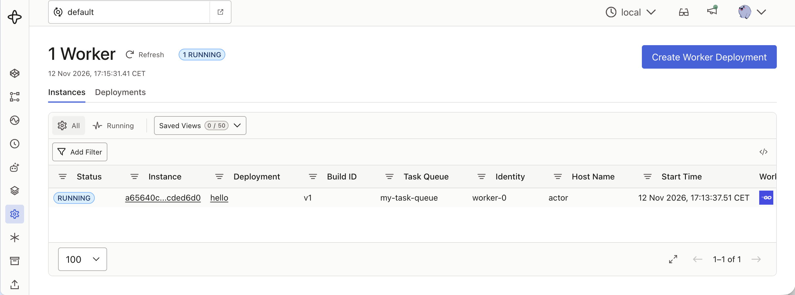
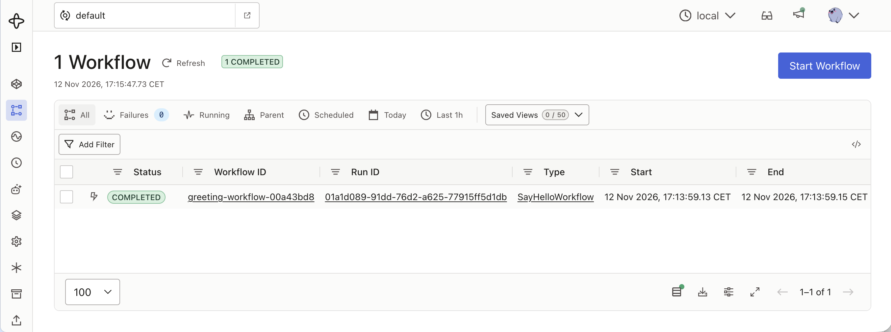
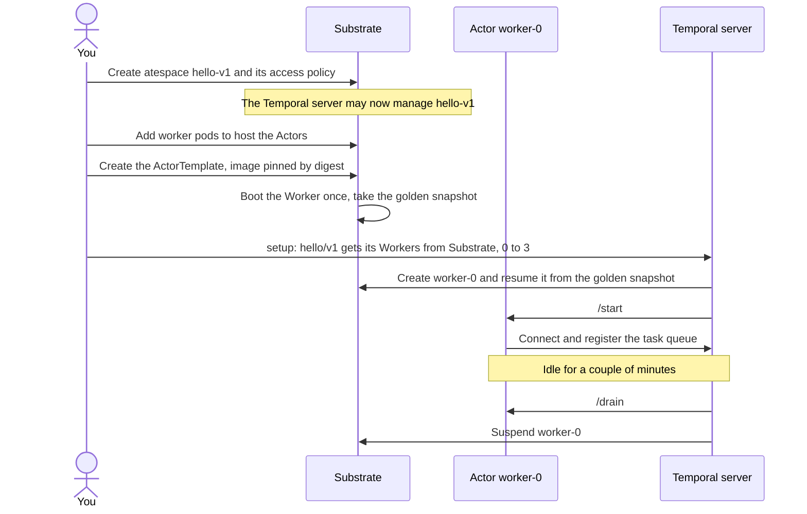
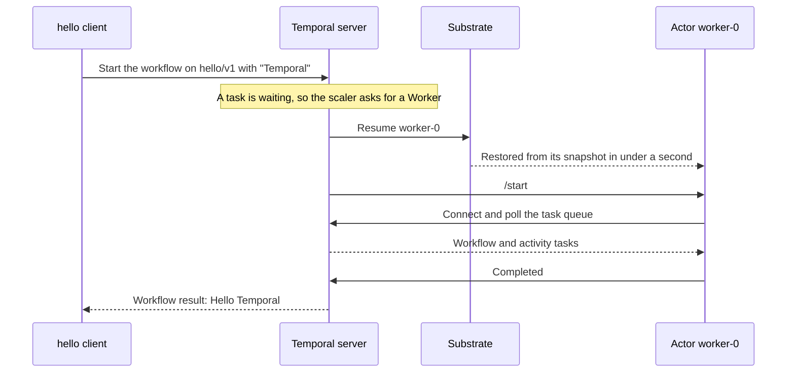
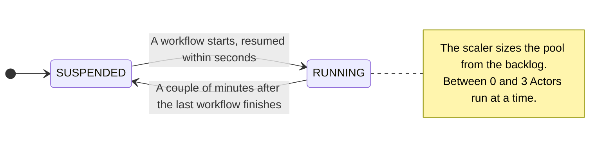
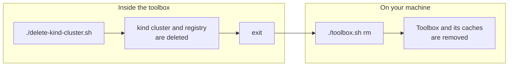
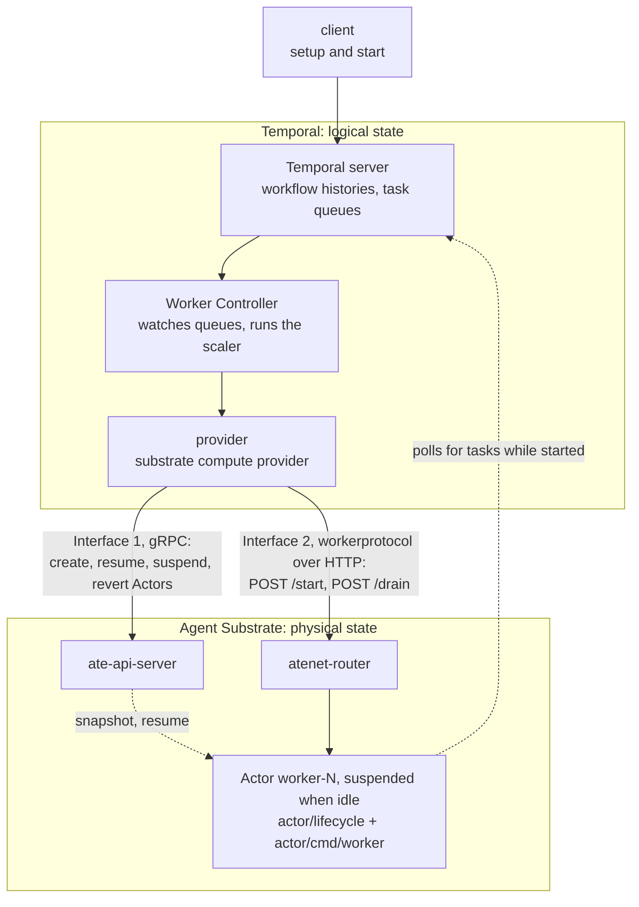
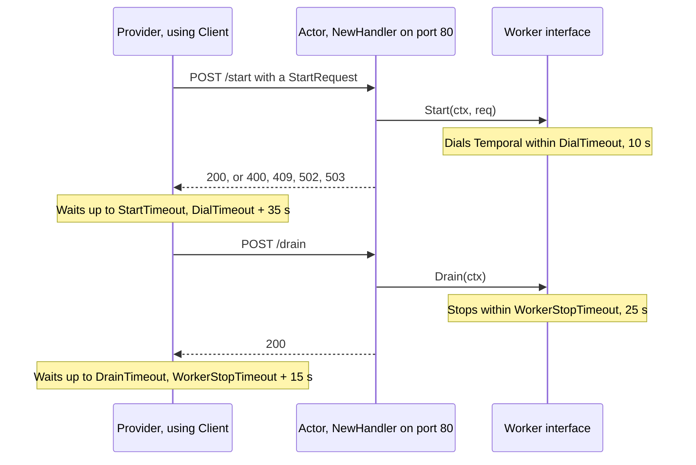
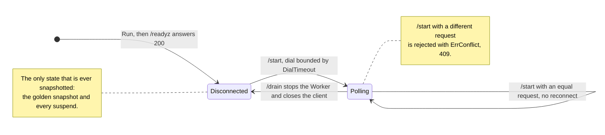
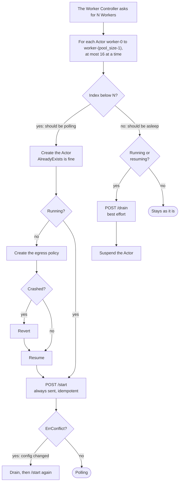

# Getting started

You'll run [Temporal's Go Hello World](https://docs.temporal.io/develop/go/set-up-your-local-go) with its [Worker](https://docs.temporal.io/serverless-workers) inside an [Agent Substrate](https://github.com/agent-substrate/substrate) [Actor](https://ate.dev/docs/concepts/architecture/) that is suspended whenever there is no work. When a workflow starts, Temporal asks Substrate for a Worker, the Actor resumes from a snapshot in under a second, runs the workflow, and is suspended again once idle.

```
 you ──► Temporal server ── "need a Worker for hello/v1" ──► Substrate
              ▲                                                │ resume
              └──────────── Worker polls, runs workflow ◄── Actor worker-0
```

Everything runs locally in a `kind` cluster based on the Agent Substrate [Quickstart](https://github.com/agent-substrate/substrate#quickstart-development).





## Before you start

You only need **Docker**. Go, kubectl and all the builds run in a toolbox container that uses your Docker.

> [!TIP]
> - On **macOS or Windows**, enable host networking in Docker Desktop: *Settings → Resources → Network → Enable host networking*.
> - Give Docker plenty of memory and disk.

Open the toolbox. The rest of this guide runs inside it:

```bash
./toolbox.sh
```

Your prompt changes to `toolbox:/work$`.
- This repo is at `$REPO`.
- The pinned versions from `versions.env` are set as environment variables.
- Type `exit` to leave
- Type `./toolbox.sh` again opens another shell in the same toolbox

## 1. Create the kind cluster with Substrate

These are Substrate's own quickstart commands:

```bash
git clone https://github.com/agent-substrate/substrate.git
git -C substrate checkout $SUBSTRATE_REF && cd substrate

hack/create-kind-cluster.sh            # kind cluster + image registry on localhost:5001
export ATE_INSTALL_KIND=true
go run ./cmd/ate-setup deploy ate-system --credential-provider='{"name":"k8s.io"}' \
  --ingress-allowed-spiffe-ids=spiffe://cluster.local/ns/ate-system/sa/atenet-client,spiffe://cluster.local/ns/temporal/sa/temporal-server
go run ./cmd/ate-setup deploy demo counter
go install ./cmd/kubectl-ate           # adds `kubectl ate`
cd /work
```

> [!NOTE]
> There is one addition to the quickstart:
> - The second SPIFFE ID lets the Temporal server reach Worker Actors through Substrate's router.
> 
> The counter demo is installed only for its worker image, which [step 5](#5-deploy-the-actor) reuses.

## 2. Build Temporal

```bash
docker build -t localhost:5001/temporal-server-substrate:dev -f $REPO/temporal-server/Dockerfile \
  --build-arg TEMPORAL_REF --build-arg WCI_REF --build-arg SUBSTRATE_REF $REPO
docker push localhost:5001/temporal-server-substrate:dev
```

The [Dockerfile](temporal-server/Dockerfile) builds a Temporal server that can hand Worker scaling to Substrate:

- It fetches the Temporal server and its Worker Controller (the part that scales Workers) at the pinned commits.
- It adds the [`substrate` compute provider](provider) to the Worker Controller, and runs its tests.
- It compiles the server with the provider included.

This is the longest build.

## 3. Deploy Temporal

```bash
kubectl apply -f $REPO/temporal-server/deploy/temporal.yaml
kubectl -n temporal rollout status deploy/temporal-server
```

This deploys a single-pod Temporal dev server (in-memory, so a restart forgets everything) and its Web UI.

The [manifest](temporal-server/deploy/temporal.yaml) also gives the server an identity and credentials for Substrate, and turns on the Worker Controller with the `substrate` provider.

## 4. Build the Actor

```bash
docker build -t localhost:5001/hello-worker:v1 -f $REPO/actor/Dockerfile \
  --build-arg TEMPORAL_SDK_VERSION $REPO
docker push localhost:5001/hello-worker:v1

docker build -t localhost:5001/hello-client:dev -f $REPO/client/Dockerfile \
  --build-arg TEMPORAL_SDK_VERSION --build-arg TEMPORAL_API_VERSION $REPO
docker push localhost:5001/hello-client:dev
```

- **`hello-worker` is the Actor.** It runs the quickstart's [workflow and activity](actor) with one difference: it doesn't connect to Temporal on its own. It waits for the provider to call `/start` and disconnects on `/drain` ([`actor/lifecycle`](actor/lifecycle)). That way it is never connected while Substrate snapshots it.
- **`hello-client`** is the quickstart's starter, plus a setup program for step 5.

## 5. Deploy the Actor



Each Worker version gets its own atespace (Substrate's grouping of Actors). Create one for `hello/v1` and let the Temporal server manage it:

```bash
kubectl ate create atespace hello-v1
kubectl ate create access-policy -a hello-v1 -f $REPO/actor/deploy/access-policy.yaml
```

Add worker pods to host the Actors. This reuses the counter demo's worker image:

```bash
WORKER_IMAGE=$(kubectl get workerpool counter -n ate-demo-counter -o jsonpath='{.spec.workerImage}')
sed "s|WORKER_IMAGE|$WORKER_IMAGE|" $REPO/actor/deploy/worker-pool.yaml | kubectl apply -f -
```

Create the `ActorTemplate`.  
Substrate requires the image pinned by digest.  
It then boots the Worker once and snapshots it (the *golden snapshot*), and every Actor starts from that snapshot:

```bash
IMAGE=$(docker inspect --format '{{index .RepoDigests 0}}' localhost:5001/hello-worker:v1)
sed "s|HELLO_WORKER_IMAGE|$IMAGE|" $REPO/actor/deploy/hello-worker-template.yaml | kubectl ate create actor-template -f -
until kubectl ate get actor-template hello-worker -a hello-v1 -o yaml | grep -q goldenTag; do sleep 5; done
```

Finally, tell Temporal that version `hello/v1` gets its Workers from Substrate:

```bash
kubectl -n temporal run setup --rm -i --restart=Never --image-pull-policy=Always \
  --image=localhost:5001/hello-client:dev --command -- /setup
```

[`setup`](client/setup/main.go) registers the version with a compute config:
- provider `substrate` (atespace `hello-v1`, up to 3 Actors) and
- a scaler that goes from 0 to 3 Workers.  

Right away, `worker-0` resumes once so the Worker can register its task queue with Temporal.  
It is suspended again after a couple of minutes.

## 6. Send a request



```bash
kubectl -n temporal run hello --rm -i --restart=Never --image-pull-policy=Always \
  --image=localhost:5001/hello-client:dev -- Temporal
```

Expect `Workflow result: Hello Temporal` after a few seconds.

## 7. See it scale



Open a second toolbox shell (`./toolbox.sh` in another terminal) and watch the Actors:

```bash
watch -n2 kubectl ate get actors -a hello-v1
```

Run step 6 again and look for:

1. **Idle:** `worker-0` is `SUSPENDED`.
2. **Workflow starts:** `worker-0` turns `RUNNING` within seconds.
3. **A couple of minutes after it finishes:** `worker-0` is `SUSPENDED` again.

Start three at once. The pods run detached, so they don't compete for your terminal:

```bash
for i in {1..3}; do
  kubectl -n temporal run hello-$i --restart=Never --image=localhost:5001/hello-client:dev -- "Run $i"
done
kubectl -n temporal wait --for=jsonpath='{.status.phase}'=Succeeded pod/hello-1 pod/hello-2 pod/hello-3 --timeout=180s
for i in {1..3}; do kubectl -n temporal logs hello-$i | tail -1; done
kubectl -n temporal delete pod hello-1 hello-2 hello-3

# Alternatively, delete all pods that succeeded successfully
kubectl delete pod --field-selector=status.phase==Succeeded -n temporal
```

The scaler sizes the pool from the backlog, so you may see one Actor resume or several. Hello World finishes in milliseconds, so a single Worker often drains all three runs before a second one is needed.

More to look at:

```bash
kubectl ate logs actor worker-0 -a hello-v1                  # "polling" after /start, "drained" before suspend
kubectl -n temporal port-forward svc/temporal-ui 8080:8080   # Web UI on http://localhost:8080 → Workflows
```

You can now point your browser at [http://localhost:8080](http://localhost:8080) to access the Temporal Web UI.

## 8. Turn it down



Turn down and delete the `kind` cluster.

```bash
cd /work/substrate/hack/
./delete-kind-cluster.sh    # the cluster and the registry
exit
```

Then, on your machine:

```bash
./toolbox.sh rm             # exit the toolbox and remove its caches
```

---

## If something goes wrong

| Symptom | Try |
|---|---|
| Step 1 fails to connect to the cluster | Host networking is off in Docker Desktop. |
| A `docker build` fails | Build output is printed; re-running continues from Docker's build cache. |
| Step 5 `setup` fails with `PermissionDenied` or `Unauthenticated` | `kubectl -n temporal exec deploy/temporal-server -- ls /var/run/ate` should list `ca.crt` and `credential-bundle.pem`. Then check the access policy: `kubectl ate get access-policy -a hello-v1 -o yaml`. |
| Step 6 hangs, no Actor resumes | `kubectl -n temporal logs deploy/temporal-server \| grep -i substrate` |
| Temporal pod restarted | Its state is in memory: re-run the `setup` command from step 5. |

To see how the pieces fit together, read [README.md](README.md).

> **Status:** the provider, the protocol and the Worker lifecycle are unit-tested, and the Temporal build (step 2) runs the provider's tests against the real dependencies. This guide hasn't been run end to end yet.


---

# Appendix: the code and the decisions behind it

This appendix walks through every piece of code the demo adds: what each one does, the lines that matter, and why it ended up this way. Go has no classes, so "key types" below means structs and interfaces.

- [A. The big picture](#a-the-big-picture)
- [B. `workerprotocol`: the contract](#b-workerprotocol-the-contract)
- [C. `actor/lifecycle`: an actor-ready Worker](#c-actorlifecycle-an-actor-ready-worker)
- [D. `provider`: the substrate compute provider](#d-provider-the-substrate-compute-provider)
- [E. Packaging and deployment](#e-packaging-and-deployment)
- [F. How we got here](#f-how-we-got-here)
- [G. Decisions at a glance](#g-decisions-at-a-glance)
- [H. Known limitations](#h-known-limitations)

## A. The big picture

Two systems meet in this demo:

- **Temporal** keeps the *logical* state of the work: workflow histories, timers, retries.
- **Agent Substrate** keeps the *physical* state of sandboxes. It snapshots a process (memory and filesystem) out of a worker pod when it is idle, and resumes it in well under a second when it is needed.

Temporal's **Serverless Workers** feature decides *when* a Worker should run. Its open-source **Worker Controller (WCI)** watches each Worker Deployment Version's task queues, runs a scaling algorithm, and asks a **compute provider** to start or stop Workers. The demo adds one such provider, `substrate`, which makes Substrate Actors the Workers.



| Module | Side | Size | Role |
|---|---|---|---|
| [`workerprotocol`](workerprotocol) | shared | ~210 lines | The HTTP contract between the provider and a Worker |
| [`actor/lifecycle`](actor/lifecycle) | Substrate | ~245 lines | Turns any Temporal Worker into a Worker that is safe to snapshot |
| [`actor/cmd/worker`](actor/cmd/worker/main.go) | Substrate | 36 lines | The hello-world app: registers the workflow and activity |
| [`provider`](provider) | Temporal | ~730 lines | The `substrate` compute provider, compiled into the Temporal server |
| [`client`](client) | demo | ~220 lines | `setup` registers the version; `start` runs the workflow |
| Tests | — | ~1,070 lines | 30 tests across protocol, lifecycle and provider |

There are exactly two interfaces between the sides:

1. **Provider → Substrate API (`ate-api-server`, gRPC).** Create, resume, suspend and revert Actors, and create their egress policies.
2. **Provider → Worker (`workerprotocol`, HTTP through `atenet-router`).** `POST /start` after a resume, `POST /drain` before a suspend.

## B. `workerprotocol`: the contract

**File:** [`workerprotocol/protocol.go`](workerprotocol/protocol.go). This is the only code both sides import. It uses only the standard library, so adding it to the Temporal server build pulls in nothing else.



### Key types

| Type | Purpose |
|---|---|
| `StartRequest` | Everything a Worker needs to connect: `Identity`, `Address`, `TLS`, `Namespace`, `DeploymentName`, `BuildID`. It has a `Validate()` method, which both sides call. |
| `Worker` (interface) | What runs in the Actor: `Ready()`, `Start(ctx, StartRequest)`, `Drain(ctx)`. |
| `NewHandler(Worker)` | The server side. It maps the interface onto `GET /readyz`, `POST /start` and `POST /drain`, plus status codes: 400 invalid request, 409 conflict, 502 Temporal unreachable, 503 not ready. |
| `Client` | The client side. `Dial` is a function that supplies the connection; for the provider, it opens a tunnel through `atenet-router`. |
| `ErrConflict` | "Already started with a different request." It travels as HTTP 409 and comes back as an error that `errors.Is` matches. |

### Key lines

The timing budget. The invariants hold *by construction*: each side's timeout is defined from the other's, so they can't be configured out of order.

```go
DialTimeout       = 10 * time.Second
StartTimeout      = DialTimeout + 35*time.Second      // provider waits longer than the Worker's dial
WorkerStopTimeout = 25 * time.Second
DrainTimeout      = WorkerStopTimeout + 15*time.Second // provider waits longer than the Worker's drain
```

`Port = 80` is the one other shared constant. The `ActorTemplate`'s wakeup probe must use the same port.

### Why it looks like this

- **One definition, two users.** At first the protocol existed only as matching string literals in two places: `"/start"` and `"80"` in the provider, `":80"` and `"POST /start"` in the Worker. The rule "the provider must wait longer than the Worker" was just a comment. Moving it into one module removed that drift risk.
- **Standard library only.** The provider is compiled *inside* the Temporal server. Every dependency it adds becomes the server's dependency, so the contract module adds none.
- **Contract tests.** `protocol_test.go` runs the real `Client` against the real `NewHandler`. In addition, each side tests its own code against the other side's real code: the lifecycle tests drive `ActorWorker` through `Client`, and the provider's router test puts `NewHandler` behind a fake router.

## C. `actor/lifecycle`: an Actor-ready Worker

**Files:**

- [`lifecycle.go`](actor/lifecycle/lifecycle.go): the state machine. No Temporal SDK code.
- [`temporal.go`](actor/lifecycle/temporal.go): the Temporal SDK adapter.



### The interface an app sees

```go
lifecycle.Run(ctx, lifecycle.Options{
	TaskQueue: "my-task-queue",
	Register:  func(r lifecycle.Registry) { r.RegisterWorkflow(...); r.RegisterActivity(...) },
})
```

That is the whole of [`cmd/worker/main.go`](actor/cmd/worker/main.go). Everything else is behind `Run`.

### Key types

| Type | Purpose |
|---|---|
| `Options` | `TaskQueue`, `Register`, and an optional `CAFile` for TLS frontends. |
| `Registry` | `RegisterWorkflow` and `RegisterActivity`. The SDK's `worker.Worker` satisfies it, which keeps `lifecycle.go` free of SDK imports. |
| `actorWorker` | Implements `workerprotocol.Worker`. It holds at most one `session`. |
| `session` / `connectFunc` | The seam between the state machine and Temporal. `sdkConnect` (in `temporal.go`) is the real adapter; the tests use a fake. |

### Key lines

`Start` is idempotent for an equal request, rejects a different one, and bounds the dial:

```go
if w.current != nil {
	if *w.current == req { return nil }       // repeat /start: no reconnect
	return workerprotocol.ErrConflict         // different version or address: provider must drain first
}
ctx, cancel := context.WithTimeout(ctx, workerprotocol.DialTimeout)
s, err := w.connect(ctx, req)
```

`Drain` stops the session and forgets it. After it returns, nothing is connected:

```go
if w.sess != nil {
	w.sess.Stop()                 // worker.Stop() (bounded by WorkerStopTimeout), then client.Close()
	w.current, w.sess = nil, nil
}
```

Both methods hold one mutex. A `/drain` that arrives while a `/start` is still dialing waits for the dial to finish, then stops it.

In `temporal.go`, `sdkConnect` builds the SDK client and Worker entirely from the request:

```go
copts := client.Options{HostPort: req.Address, Namespace: req.Namespace, Identity: req.Identity}
...
worker.DeploymentOptions{
	UseVersioning: true,
	Version: worker.WorkerDeploymentVersion{DeploymentName: req.DeploymentName, BuildID: req.BuildID},
	...
}
```

With `TLS: true` (for example Temporal Cloud), it sends `apiKeyPlaceholder` as the API key, and Substrate's egress gateway swaps in the real one. The secret never enters the sandbox, so no snapshot can contain it.

### Why it looks like this

- **Never connected while snapshotted.** This is the central design decision of the demo. An early worry was whether a Worker's gRPC connections and in-flight long-polls would survive a suspend and resume. Instead of testing that and hoping, the design makes it irrelevant:
  - The golden snapshot is taken right after `/readyz` first answers 200, before any `/start`.
  - Every later suspend is preceded by `/drain`.
- **Initialize before `Run`.** Every Actor starts from the golden snapshot. Expensive work done before `Run` is paid once, but anything created there is *shared* by every Actor, so per-Actor values (IDs, random seeds) must be created in `/start`.
- **No Temporal settings in the Actor.** Earlier versions put `TEMPORAL_ADDRESS`, the deployment name and the build ID into the `ActorTemplate`'s environment. The same values also had to appear in the provider's config, so a mismatch failed silently: a 502, or a Worker polling the wrong version. Now the provider sends them in `/start`, and the template holds only the image.
- **The SDK is behind a seam.** `lifecycle.go` has no SDK imports, so the state machine can be tested without a Temporal server: idempotency, conflict, retry after a failed connect, and one connection under five concurrent `/start` calls.

## D. `provider`: the substrate compute provider

**Files:**

- [`substrate.go`](provider/substrate.go): reconciliation, config and errors.
- [`substrate_router.go`](provider/substrate_router.go): tunnels through `atenet-router`.
- [`substrate_dial.go`](provider/substrate_dial.go): connections and TLS.
- [`patches/0001-…patch`](provider/patches/0001-add-substrate-compute-provider-type.patch): registers the type with the WCI.



### How it plugs in

The WCI defines a four-method `ComputeProvider` interface. A provider registers itself by type string in `init()`:

```go
func init() {
	RegisterComputeProvider(iface.ComputeProviderTypeSubstrate, NewSubstrateComputeProvider)
}
```

The WCI validates provider types against a closed list, so the three-line patch adds `ComputeProviderTypeSubstrate = "substrate"` to it. The `//go:build computeprovider_substrate` tag keeps the provider out of builds that don't ask for it, like the WCI's own `k8s` and `subprocess` providers.

### Key types

| Type | Purpose |
|---|---|
| `substrateComputeProvider` | The provider. Its fields are `control` and `workers`. |
| `actorControl` (interface) | The seven `ate-api-server` calls it uses. The real generated `ateapi.ControlClient` satisfies it; this was checked signature by signature against Substrate's generated code. The tests use an in-memory fake. |
| `workerLifecycle` (interface) | `Start(ctx, actor, StartRequest)` and `Drain(ctx, actor)`. `routerWorkers` is the adapter; the tests use a fake. |
| `substrateConfig` | The parsed compute config. It also builds the `/start` request. |
| `routerWorkers` | `workerprotocol.Client` over a tunnel through `atenet-router`. |

### Key lines: the reconcile loop

The WCI tells the provider "N Workers". The provider makes it true for Actors `worker-0` to `worker-(pool_size-1)`:

```go
for i := int32(0); i < cfg.poolSize; i++ {
	name := cfg.actorName(i)                                   // "worker-<i>"
	switch {
	case i < size:                          // should be polling
		tasks = append(tasks, ... p.ensurePolling(ctx, rc, cfg, name, exists, state))
	case exists && isRunningOrResuming(state):  // should be asleep
		tasks = append(tasks, ... p.drainAndSuspend(ctx, cfg, name))
	}
}
return classifySubstrateError(runBounded(ctx, substrateConcurrency, tasks))
```

- **Stateless.** Everything is derived from Actor names and current Actor states. The WCI retries failed activities, so the provider must be safe to call again at any point.
- **Lowest indices stay up.** Scale-down always removes the newest Actors first.
- **Bounded parallelism.** `runBounded` runs at most 16 Actors at a time and joins all errors, so one broken Actor doesn't stop the rest of the pool from converging.

`ensurePolling` runs in a deliberate order:

1. Create the Actor (`AlreadyExists` is fine).
2. If it isn't running: create the egress policy, revert if it crashed, then resume.
3. Always send `/start`.

The policy comes **before** the first resume because Substrate's egress gateway caches a missing policy as a deny for about 10 seconds; a Worker resumed first would fail its first dial. `/start` is sent even to running Actors because it is idempotent, and it repairs a retry where the resume succeeded but the start didn't. If `/start` returns `ErrConflict` (the config changed), the provider drains the Worker and starts it again.

`startRequest` is where "single source of truth" happens:

```go
return workerprotocol.StartRequest{
	Identity:       name,
	Address:        net.JoinHostPort(c.temporalHost, strconv.Itoa(int(c.temporalPort))),
	TLS:            c.temporalTLS,
	Namespace:      rc.NamespaceName,       // from the WCI
	DeploymentName: rc.DeploymentName,      // from the WCI
	BuildID:        rc.DeploymentBuildID,   // from the WCI
}
```

`ensureEgressPolicy` builds the Actor's only allowed destination from the same `temporalHost` and `temporalPort`:

- an `https` rule for TLS, optionally replacing the `Authorization` header with a stored credential;
- an `http` (h2c) rule for the cleartext dev server.

So the address a Worker dials and the address it is *allowed* to dial can't diverge.

`drainAndSuspend` is best effort:

```go
drainCtx, cancel := context.WithTimeout(ctx, workerprotocol.DrainTimeout)
_ = p.workers.Drain(drainCtx, cfg.ref(name))   // if this fails, Temporal retries the task elsewhere
cancel()
_, err := p.control.SuspendActor(ctx, ...DURABILITY_MODE_ASYNCHRONOUS...)
```

### Key lines: connections

The WCI calls a provider's constructor on **every activity**, so the connections are created once per process and shared:

```go
if sharedControl == nil {
	control, workers, err := dialSubstrate(ctx, dc)
	if err != nil { return nil, ... }          // not cached: the next activity retries
	sharedControl, sharedWorkers = control, workers
}
```

`routerWorkers.tunnel` does what `kubectl ate proxy` does. It opens TLS to `atenet-router:8444`, then sends `CONNECT worker-0:80` with the header `ate-target-actor: hello-v1/worker-0`. The router resumes the Actor if needed and forwards the bytes. The tunnel returns a `bufferedConn`, so no bytes the reader buffered past the CONNECT response get lost.

`substrateTLS` handles Kubernetes pod certificates. The kubelet rotates them, so both the client certificate and the CA bundle are read again on **every handshake**:

```go
pair, err := tls.X509KeyPair(pem, pem)   // one file: key + chain; X509KeyPair picks each part out
...
InsecureSkipVerify: true,                  // standard verification, done in VerifyConnection
VerifyConnection: func(cs tls.ConnectionState) error { ... roots, err := loadPool(caFile) ... }
```

`InsecureSkipVerify` is only there to swap in a CA pool that is reloaded per handshake. `VerifyConnection` still does full chain and hostname verification, and a test checks that a certificate for the wrong name is rejected.

### Config

| Key | Meaning |
|---|---|
| `atespace`, `actor_template` | Where the pool lives and what it runs |
| `temporal_host`, `temporal_port`, `temporal_tls`, `temporal_credential_uri` | The frontend: sent in `/start` and allowed in egress |
| `pool_size` | Number of Actors (≥ the scaler's `max_count`) |

Unknown keys are rejected, so a typo like `pool_sise` fails at validation instead of silently using the default. Endpoints and credentials for Substrate itself are **not** in this config. They come from the server's environment, so a tenant can't point the server's Substrate identity at another host.

### Why it looks like this

- **A provider, not a new controller.** The first plan was to write our own Worker Controller. Reading Temporal's source showed that the WCI is generic and has a pluggable provider interface, so a provider is all that's needed.
- **`worker-set`, not `invoke`.** Lambda-style providers *invoke* a short-lived Worker per scaling event and never stop it. That works only if the platform reclaims idle compute by itself. Substrate's code shows it doesn't: only its template controller and benchmarks call `SuspendActor`. With `worker-set`, the WCI's own scale-down decisions drive suspends.
- **One atespace per version.** Ownership is explicit (everything in `hello-v1` belongs to `hello/v1`), access policies are per version, and one config knob (`name_prefix`) disappeared.
- **Errors mapped to WCI classes.** `classifySubstrateError` maps gRPC codes to the WCI's retry semantics. For example, `Unavailable` → retry, `PermissionDenied` → access problem, `InvalidArgument` → rejected config.

## E. Packaging and deployment

| File | Key lines and why |
|---|---|
| [`temporal-server/Dockerfile`](temporal-server/Dockerfile) | Fetches Temporal, the WCI and Substrate at the commits in `versions.env`, then patches and runs `go test` on the provider before building. Step 1b turns Substrate's generated API package (`api/ateapi/v1`) into a module of its own, requiring gRPC and protobuf at the *server's* versions. Pointing `go.ate.dev/substrate` at the whole repo would add all of Substrate's requirements to the server's dependencies. The `replace` directives are set on **both** the WCI and the server module, because Go ignores `replace` in dependencies. The last line, `go tool nm … \| grep substrateComputeProvider`, fails the build if the provider didn't make it into the binary. |
| [`temporal-server/deploy/temporal.yaml`](temporal-server/deploy/temporal.yaml) | Dynamic config `workercontroller.enabled` and `compute_providers.enabled: ["substrate"]`; an unlisted provider behaves as if it didn't exist. A projected volume holds `ca.crt` (Substrate's service CA) and `credential-bundle.pem` (a pod certificate with SPIFFE ID `…/ns/temporal/sa/temporal-server`). The namespace label `ate.dev/api-access=true` lets Substrate's NetworkPolicy admit the pod. `enableServiceLinks: false` stops Kubernetes from injecting `TEMPORAL_UI_PORT=tcp://…` (from the `temporal-ui` Service), which the UI otherwise reads as its port and crashes on. |
| [`actor/deploy/hello-worker-template.yaml`](actor/deploy/hello-worker-template.yaml) | Image by digest; `wakeupProbe` on `/readyz:80` (this gates resumes, and it is the moment the golden snapshot is taken); `SNAPSHOT_FIDELITY_MEMORY`. Deliberately no Temporal settings and no golden egress policy. |
| [`actor/deploy/access-policy.yaml`](actor/deploy/access-policy.yaml) | `editor` on atespace `hello-v1` for the server's SPIFFE ID, and nothing more. |
| [`client/setup/main.go`](client/setup/main.go) | `CreateWorkerDeploymentVersion` with a `ComputeConfig`: provider `substrate`, scaler `rate-based` (`min_count 0`, `initial_count 1`, `max_count 3`). `initial_count 1` starts one Worker right away, so the task queue gets registered with the version; without it, the WCI has no queue to watch. The scaler polls metrics every 30 s, its minimum; the Worker Controller rejects shorter intervals. The calls mirror the WCI's own integration tests. |
| [`client/start/main.go`](client/start/main.go) | The quickstart starter, pinned to `hello/v1` with `PinnedVersioningOverride`. Each run gets its own workflow ID: the quickstart's fixed `greeting-workflow` made parallel runs collide. Without a version, the task would wait for an unversioned Worker that never comes. The workflow is started by name, so the client doesn't import the Actor's code. |
| [`toolbox.sh`](toolbox.sh), [`tools/Dockerfile`](tools/Dockerfile) | Go, the Docker CLI and kubectl in a container that shares the host's Docker socket and **network**. Host networking is what lets Substrate's kind script and the `localhost:5001` registry work unchanged. |

## F. How we got here

The design came out of a sequence of discoveries. Each step below names what we learned and what changed because of it.

1. **Brainstorm.** We looked at several ways to combine Temporal and Substrate:
   - a sandbox as an Activity;
   - snapshot-linked workflow history;
   - Substrate as a target for Serverless Workers.

   The third is the most strategic: it would let platforms run customer-supplied Worker code in VM-grade sandboxes that scale to zero.
2. **Temporal's Serverless Workers are open source.** The plan was to implement a Worker Controller. Reading [`temporal-auto-scaled-workers`](https://github.com/temporalio/temporal-auto-scaled-workers) showed the controller already exists and is generic. **Change:** write a compute provider, not a controller.
3. **Read the real interfaces.** The provider interface had changed since its March docs (every method gained a `RequestContext`). Provider types are a closed enum, which led to the patch. Substrate exposes `ResumeActor`, `SuspendActor` and `RevertActor`, golden snapshots, and per-Actor egress policies.
4. **Substrate doesn't suspend idle Actors.** Only callers of `SuspendActor` do. **Change:** `worker-set` instead of `invoke`.
5. **The reconnect risk.** Would a Worker survive having its connections frozen into a snapshot? **Change:** the Worker is disconnected whenever it might be snapshotted. This introduced `/start` and `/drain`.
6. **Going through the router.** To reach a Worker, the provider needs a pod certificate whose SPIFFE ID the router allows, and it needs the CONNECT tunnel that `kubectl ate proxy` uses. **Change:** `routerWorkers` and `substrateTLS`, tested against a local mTLS router.
7. **A real bug, found by reading the WCI.** The WCI calls provider constructors on every activity, so the first version opened (and leaked) a new connection on every call. **Change:** process-wide shared connections.
8. **Egress details.** Actors don't inherit egress policies, and a missing policy is cached as a deny. **Change:** the provider creates the policy, before the first resume.
9. **Separating the components.** The first repo mixed everything in one folder. **Change:** `provider/`, `temporal-server/`, `actor/` and `client/`.
10. **Architecture review.** Four improvements:
    - **A:** a deep `lifecycle` module;
    - **B:** the provider as the single source of the Worker's settings;
    - **C:** one shared `workerprotocol`;
    - **D:** one atespace per version.

    All four were implemented, plus strict config keys.
11. **Making it runnable.** All builds moved into Docker, and Docker became the only host requirement. A one-command version proved too opaque, so this guide shows each core step as plain commands in a toolbox shell.
12. **The first real build.** The provider's tests passed against the real Temporal and Substrate code, but the server failed to compile. Using the whole Substrate repo as a module had raised `go.opentelemetry.io/otel/log` from v0.20.0 to v0.21.0, and the server's `common/wideevents` code doesn't compile against that. **Change:** an API-only module that leaves every server dependency at its version. It was then compiled against the real gRPC and protobuf.

## G. Decisions at a glance

| Decision | Why | Rejected alternative |
|---|---|---|
| Compute provider inside the existing WCI | The WCI is open source and generic | Writing our own controller |
| `worker-set` launch strategy | Substrate needs explicit suspends | `invoke`: nothing would ever suspend |
| Never connected while snapshotted (`/start`, `/drain`) | Removes the reconnect-after-resume risk entirely | Relying on the SDK to reconnect after a restore |
| Provider sends the version and frontend in `/start` | One owner; egress and dial address can't diverge | Temporal settings in the `ActorTemplate`'s environment |
| One atespace per version | Explicit ownership and per-version access | Shared atespace with name prefixes |
| Shared stdlib-only `workerprotocol` | One contract, tested from both sides, no new server dependencies | Matching literals on each side |
| Egress policy before the first resume | Substrate caches a missing policy as a deny | Creating it lazily |
| Shared connections per process | The WCI constructs providers per activity | A connection per provider instance (leaks) |
| Credentials injected by the egress gateway | Secrets never enter a sandbox or a snapshot | API keys in the Actor's environment |
| Substrate's API as its own module at the server's gRPC/protobuf versions | The provider needs only the generated API; the full module dragged in Substrate's dependency graph | `replace` to the whole Substrate repo (broke the server build) |
| All builds in Docker, toolbox with host networking | Docker is the only prerequisite; Substrate's scripts run unchanged | Host builds, or rewriting Substrate's kind script |

## H. Known limitations

- **Self-hosted only.** The WCI is compiled into the Temporal server. For Temporal Cloud, the provider would have to be accepted upstream.
- **Dependencies.** Both the WCI and Substrate are evolving: the provider interface already changed once during this work.
- **In-memory Temporal.** The dev server forgets everything on restart. Re-run `setup`.
- **Open TODOs in the provider:**
  - update an existing egress policy when the config changes;
  - check for a golden snapshot in `ValidateConfig`;
  - move operator settings to dynamic config.
